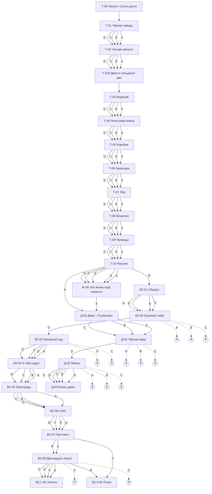

# Отчёт валидатора (генерируется, не править руками)

Сцен: 27, смертей: 13, узлов «сцена × живое состояние»: 215404

## Проблемы

- ✅ ошибок нет

## Схема

## Шапки сцен (диапазоны на входе по всем достижимым путям)

### Т-00. Пролог. Сухое русло
ВХОДЫ: старт · узлов: 1
ДИАПАЗОНЫ: ТЕЛ 20 · РАЗ 20 · ЭМП 20 · ВОЛ 20 · ДАР 0 · ДРЕЙФ 0 · СВЯЗЬ_НИКА 0 · СВЯЗЬ_ВИТЬКА 20 · СВЯЗЬ_МАМА 40 · СВЯЗЬ_ОТЕЦ 30 · СВЯЗЬ_ЛУНЁВ 0
ФЛАГИ: нет

### Т-01. Чёрная заводь
ВХОДЫ: Т-00 · узлов: 1
ДИАПАЗОНЫ: ТЕЛ 20 · РАЗ 20 · ЭМП 20 · ВОЛ 20 · ДАР 0 · ДРЕЙФ 0 · СВЯЗЬ_НИКА 0 · СВЯЗЬ_ВИТЬКА 20 · СВЯЗЬ_МАМА 40 · СВЯЗЬ_ОТЕЦ 30 · СВЯЗЬ_ЛУНЁВ 0
ФЛАГИ: нет

### Т-02. Четыре минуты
ВХОДЫ: Т-01 · узлов: 4
ДИАПАЗОНЫ: ТЕЛ 20–25 · РАЗ 15–30 · ЭМП 15–30 · ВОЛ 15–30 · ДАР 0–5 · ДРЕЙФ 0 · СВЯЗЬ_НИКА 0–10 · СВЯЗЬ_ВИТЬКА 20–30 · СВЯЗЬ_МАМА 40 · СВЯЗЬ_ОТЕЦ 30 · СВЯЗЬ_ЛУНЁВ 0
ФЛАГИ: F_Т01 ∈ {БУБЛИК, ДОЛГ, СПОР, ЧАСЫ}

### Т-02б. Двести пятьдесят две
ВХОДЫ: Т-02 · узлов: 16
ДИАПАЗОНЫ: ТЕЛ 20–25 · РАЗ 15–40 · ЭМП 15–40 · ВОЛ 15–40 · ДАР 0–15 · ДРЕЙФ 0 · СВЯЗЬ_НИКА 0–10 · СВЯЗЬ_ВИТЬКА 20–30 · СВЯЗЬ_МАМА 40–45 · СВЯЗЬ_ОТЕЦ 30 · СВЯЗЬ_ЛУНЁВ 0
ФЛАГИ: F_Т01 ∈ {БУБЛИК, ДОЛГ, СПОР, ЧАСЫ}; F_Т02 ∈ {ЛИЦО, МАМА, ХОР, ЧЕЙ}

### Т-03. Водяной
ВХОДЫ: Т-02б · узлов: 16
ДИАПАЗОНЫ: ТЕЛ 20–25 · РАЗ 15–40 · ЭМП 15–40 · ВОЛ 15–40 · ДАР 0–15 · ДРЕЙФ 0 · СВЯЗЬ_НИКА 0–10 · СВЯЗЬ_ВИТЬКА 20–30 · СВЯЗЬ_МАМА 40–45 · СВЯЗЬ_ОТЕЦ 30 · СВЯЗЬ_ЛУНЁВ 0
ФЛАГИ: F_Т01 ∈ {БУБЛИК, ДОЛГ, СПОР, ЧАСЫ}; F_Т02 ∈ {ЛИЦО, МАМА, ХОР, ЧЕЙ}

### Т-04. Рельсовая война
ВХОДЫ: Т-03 · узлов: 64
ДИАПАЗОНЫ: ТЕЛ 20–35 · РАЗ 15–45 · ЭМП 10–45 · ВОЛ 15–45 · ДАР 0–15 · ДРЕЙФ 0 · СВЯЗЬ_НИКА 0–10 · СВЯЗЬ_ВИТЬКА 20–30 · СВЯЗЬ_МАМА 40–45 · СВЯЗЬ_ОТЕЦ 30 · СВЯЗЬ_ЛУНЁВ 0
ФЛАГИ: F_Т01 ∈ {БУБЛИК, ДОЛГ, СПОР, ЧАСЫ}; F_Т02 ∈ {ЛИЦО, МАМА, ХОР, ЧЕЙ}; F_Т03 ∈ {ВОДОБОЯЗНЬ, ВОДЯНОЙ, ЗАМЕТКА, ШРАМ}

### Т-05. Коробка
ВХОДЫ: Т-04 · узлов: 246
ДИАПАЗОНЫ: ТЕЛ 20–45 · РАЗ 10–50 · ЭМП 10–50 · ВОЛ 15–50 · ДАР 0–15 · ДРЕЙФ 0 · СВЯЗЬ_НИКА 0–10 · СВЯЗЬ_ВИТЬКА 20–40 · СВЯЗЬ_МАМА 40–50 · СВЯЗЬ_ОТЕЦ 30–40 · СВЯЗЬ_ЛУНЁВ 0
ФЛАГИ: F_Т01 ∈ {БУБЛИК, ДОЛГ, СПОР, ЧАСЫ}; F_Т02 ∈ {ЛИЦО, МАМА, ХОР, ЧЕЙ}; F_Т03 ∈ {ВОДОБОЯЗНЬ, ВОДЯНОЙ, ЗАМЕТКА, ШРАМ}; F_Т04 ∈ {ОЛИМПИАДА, РЕЛЬСЫ, РЫНОК, ЦВЕТМЕТ}

### Т-06. Бакенщик
ВХОДЫ: Т-05 · узлов: 833
ДИАПАЗОНЫ: ТЕЛ 15–45 · РАЗ 10–55 · ЭМП 10–60 · ВОЛ 15–60 · ДАР 0–20 · ДРЕЙФ 0 · СВЯЗЬ_НИКА 0–10 · СВЯЗЬ_ВИТЬКА 20–40 · СВЯЗЬ_МАМА 40–50 · СВЯЗЬ_ОТЕЦ 30–50 · СВЯЗЬ_ЛУНЁВ 0
ФЛАГИ: F_Т01 ∈ {БУБЛИК, ДОЛГ, СПОР, ЧАСЫ}; F_Т02 ∈ {ЛИЦО, МАМА, ХОР, ЧЕЙ}; F_Т03 ∈ {ВОДОБОЯЗНЬ, ВОДЯНОЙ, ЗАМЕТКА, ШРАМ}; F_Т04 ∈ {ОЛИМПИАДА, РЕЛЬСЫ, РЫНОК, ЦВЕТМЕТ}; F_Т05 ∈ {ПРОДАЛ, СОЖЖЕНО, ТЕТРАДИ, ФОТО}

### Т-07. Лёд
ВХОДЫ: Т-06 · узлов: 3260
ДИАПАЗОНЫ: ТЕЛ 15–55 · РАЗ 10–60 · ЭМП 10–65 · ВОЛ 15–65 · ДАР 0–25 · ДРЕЙФ 0 · СВЯЗЬ_НИКА 0–25 · СВЯЗЬ_ВИТЬКА 20–50 · СВЯЗЬ_МАМА 40–50 · СВЯЗЬ_ОТЕЦ 30–50 · СВЯЗЬ_ЛУНЁВ 0
ФЛАГИ: F_Т01 ∈ {БУБЛИК, ДОЛГ, СПОР, ЧАСЫ}; F_Т02 ∈ {ЛИЦО, МАМА, ХОР, ЧЕЙ}; F_Т03 ∈ {ВОДОБОЯЗНЬ, ВОДЯНОЙ, ЗАМЕТКА, ШРАМ}; F_Т04 ∈ {ОЛИМПИАДА, РЕЛЬСЫ, РЫНОК, ЦВЕТМЕТ}; F_Т05 ∈ {ПРОДАЛ, СОЖЖЕНО, ТЕТРАДИ, ФОТО}; F_Т06 ∈ {БАКЕНЩИК, ПАЦАНЫ, ПЕРЕПЛЫЛ, ТАЙНА_НИКИ}

### Т-08. Везунчик
ВХОДЫ: Т-07 · узлов: 10196
ДИАПАЗОНЫ: ТЕЛ 15–60 · РАЗ 10–70 · ЭМП 10–70 · ВОЛ 10–75 · ДАР 0–35 · ДРЕЙФ 0 · СВЯЗЬ_НИКА 0–25 · СВЯЗЬ_ВИТЬКА 10–60 · СВЯЗЬ_МАМА 40–50 · СВЯЗЬ_ОТЕЦ 30–50 · СВЯЗЬ_ЛУНЁВ 0
ФЛАГИ: F_Т01 ∈ {БУБЛИК, ДОЛГ, СПОР, ЧАСЫ}; F_Т02 ∈ {ЛИЦО, МАМА, ХОР, ЧЕЙ}; F_Т03 ∈ {ВОДОБОЯЗНЬ, ВОДЯНОЙ, ЗАМЕТКА, ШРАМ}; F_Т04 ∈ {ОЛИМПИАДА, РЕЛЬСЫ, РЫНОК, ЦВЕТМЕТ}; F_Т05 ∈ {ПРОДАЛ, СОЖЖЕНО, ТЕТРАДИ, ФОТО}; F_Т06 ∈ {БАКЕНЩИК, ПАЦАНЫ, ПЕРЕПЛЫЛ, ТАЙНА_НИКИ}; F_Т07 ∈ {ВИДЕНИЕ, КЛЮЧИ, ЛЁД, СДАЛ}

### Т-09. Проводы
ВХОДЫ: Т-08 · узлов: 29484
ДИАПАЗОНЫ: ТЕЛ 10–65 · РАЗ 10–80 · ЭМП 10–75 · ВОЛ 10–80 · ДАР 0–40 · ДРЕЙФ 0 · СВЯЗЬ_НИКА 0–25 · СВЯЗЬ_ВИТЬКА 10–60 · СВЯЗЬ_МАМА 40–60 · СВЯЗЬ_ОТЕЦ 30–50 · СВЯЗЬ_ЛУНЁВ 0
ФЛАГИ: F_Т01 ∈ {БУБЛИК, ДОЛГ, СПОР, ЧАСЫ}; F_Т02 ∈ {ЛИЦО, МАМА, ХОР, ЧЕЙ}; F_Т03 ∈ {ВОДОБОЯЗНЬ, ВОДЯНОЙ, ЗАМЕТКА, ШРАМ}; F_Т04 ∈ {ОЛИМПИАДА, РЕЛЬСЫ, РЫНОК, ЦВЕТМЕТ}; F_Т05 ∈ {ПРОДАЛ, СОЖЖЕНО, ТЕТРАДИ, ФОТО}; F_Т06 ∈ {БАКЕНЩИК, ПАЦАНЫ, ПЕРЕПЛЫЛ, ТАЙНА_НИКИ}; F_Т07 ∈ {ВИДЕНИЕ, КЛЮЧИ, ЛЁД, СДАЛ}; F_Т08 ∈ {ДАТЧИКИ, ДОМ, ПАЛЫЧ, ТОРГ}

### Т-10. Рассвет
ВХОДЫ: Т-09 · узлов: 69259
ДИАПАЗОНЫ: ТЕЛ 10–65 · РАЗ 10–85 · ЭМП 10–85 · ВОЛ 10–85 · ДАР 0–40 · ДРЕЙФ 0 · СВЯЗЬ_НИКА 0–45 · СВЯЗЬ_ВИТЬКА 0–70 · СВЯЗЬ_МАМА 40–60 · СВЯЗЬ_ОТЕЦ 30–60 · СВЯЗЬ_ЛУНЁВ 0
ФЛАГИ: F_Т01 ∈ {БУБЛИК, ДОЛГ, СПОР, ЧАСЫ}; F_Т02 ∈ {ЛИЦО, МАМА, ХОР, ЧЕЙ}; F_Т03 ∈ {ВОДОБОЯЗНЬ, ВОДЯНОЙ, ЗАМЕТКА, ШРАМ}; F_Т04 ∈ {ОЛИМПИАДА, РЕЛЬСЫ, РЫНОК, ЦВЕТМЕТ}; F_Т05 ∈ {ПРОДАЛ, СОЖЖЕНО, ТЕТРАДИ, ФОТО}; F_Т06 ∈ {БАКЕНЩИК, ПАЦАНЫ, ПЕРЕПЛЫЛ, ТАЙНА_НИКИ}; F_Т07 ∈ {ВИДЕНИЕ, КЛЮЧИ, ЛЁД, СДАЛ}; F_Т08 ∈ {ДАТЧИКИ, ДОМ, ПАЛЫЧ, ТОРГ}; F_Т09 ∈ {АРМИЯ, ДВЕРЬ, ДОЛГ_СВАРНОМУ, НИКА}

### Д-00. Демо. «Глубокая»
ВХОДЫ: Ж-00, Т-10 · узлов: 5502
ДИАПАЗОНЫ: ТЕЛ 10–65 · РАЗ 10–85 · ЭМП 10–85 · ВОЛ 10–85 · ДАР 0–40 · ДРЕЙФ 0 · СВЯЗЬ_НИКА 0–45 · СВЯЗЬ_ВИТЬКА 0–70 · СВЯЗЬ_МАМА 40–60 · СВЯЗЬ_ОТЕЦ 30–60 · СВЯЗЬ_ЛУНЁВ 0
ФЛАГИ: F_Т01 ∈ {БУБЛИК, ДОЛГ, СПОР, ЧАСЫ}; F_Т02 ∈ {ЛИЦО, МАМА, ХОР, ЧЕЙ}; F_Т03 ∈ {ВОДОБОЯЗНЬ, ВОДЯНОЙ, ЗАМЕТКА, ШРАМ}; F_Т04 ∈ {ОЛИМПИАДА, РЕЛЬСЫ, РЫНОК, ЦВЕТМЕТ}; F_Т05 ∈ {ПРОДАЛ, СОЖЖЕНО, ТЕТРАДИ, ФОТО}; F_Т06 ∈ {БАКЕНЩИК, ПАЦАНЫ, ПЕРЕПЛЫЛ, ТАЙНА_НИКИ}; F_Т07 ∈ {ВИДЕНИЕ, КЛЮЧИ, ЛЁД, СДАЛ}; F_Т08 ∈ {ДАТЧИКИ, ДОМ, ПАЛЫЧ, ТОРГ}; F_Т09 ∈ {АРМИЯ, ДВЕРЬ, ДОЛГ_СВАРНОМУ, НИКА}; F_ПУТЬ ∈ {БАРАБАН, ЛАМПА, ПАРТИЯ, СЕМЬЯ, ТЁПЛАЯ_ВОДА, ХОР}

### Д-01. Чёрная вода
ВХОДЫ: Д-00 · узлов: 14216
ДИАПАЗОНЫ: ТЕЛ 10–95 · РАЗ 10–100 · ЭМП 10–85 · ВОЛ 10–85 · ДАР 0–70 · ДРЕЙФ 0 · СВЯЗЬ_НИКА 0–45 · СВЯЗЬ_ВИТЬКА 0–70 · СВЯЗЬ_МАМА 40–60 · СВЯЗЬ_ОТЕЦ 30–60 · СВЯЗЬ_ЛУНЁВ 0
ФЛАГИ: F_Т01 ∈ {БУБЛИК, ДОЛГ, СПОР, ЧАСЫ}; F_Т02 ∈ {ЛИЦО, МАМА, ХОР, ЧЕЙ}; F_Т03 ∈ {ВОДОБОЯЗНЬ, ВОДЯНОЙ, ЗАМЕТКА, ШРАМ}; F_Т04 ∈ {ОЛИМПИАДА, РЕЛЬСЫ, РЫНОК, ЦВЕТМЕТ}; F_Т05 ∈ {ПРОДАЛ, СОЖЖЕНО, ТЕТРАДИ, ФОТО}; F_Т06 ∈ {БАКЕНЩИК, ПАЦАНЫ, ПЕРЕПЛЫЛ, ТАЙНА_НИКИ}; F_Т07 ∈ {ВИДЕНИЕ, КЛЮЧИ, ЛЁД, СДАЛ}; F_Т08 ∈ {ДАТЧИКИ, ДОМ, ПАЛЫЧ, ТОРГ}; F_Т09 ∈ {АРМИЯ, ДВЕРЬ, ДОЛГ_СВАРНОМУ, НИКА}; F_ПУТЬ ∈ {БАРАБАН, ЛАМПА, ПАРТИЯ, СЕМЬЯ, ТЁПЛАЯ_ВОДА, ХОР}

### Д-02. Метан
ВХОДЫ: Д-01 · узлов: 14216
ДИАПАЗОНЫ: ТЕЛ 10–95 · РАЗ 10–100 · ЭМП 10–85 · ВОЛ 10–85 · ДАР 5–75 · ДРЕЙФ 0 · СВЯЗЬ_НИКА 0–45 · СВЯЗЬ_ВИТЬКА 0–70 · СВЯЗЬ_МАМА 40–60 · СВЯЗЬ_ОТЕЦ 30–60 · СВЯЗЬ_ЛУНЁВ 0
ФЛАГИ: F_Т01 ∈ {БУБЛИК, ДОЛГ, СПОР, ЧАСЫ}; F_Т02 ∈ {ЛИЦО, МАМА, ХОР, ЧЕЙ}; F_Т03 ∈ {ВОДОБОЯЗНЬ, ВОДЯНОЙ, ЗАМЕТКА, ШРАМ}; F_Т04 ∈ {ОЛИМПИАДА, РЕЛЬСЫ, РЫНОК, ЦВЕТМЕТ}; F_Т05 ∈ {ПРОДАЛ, СОЖЖЕНО, ТЕТРАДИ, ФОТО}; F_Т06 ∈ {БАКЕНЩИК, ПАЦАНЫ, ПЕРЕПЛЫЛ, ТАЙНА_НИКИ}; F_Т07 ∈ {ВИДЕНИЕ, КЛЮЧИ, ЛЁД, СДАЛ}; F_Т08 ∈ {ДАТЧИКИ, ДОМ, ПАЛЫЧ, ТОРГ}; F_Т09 ∈ {АРМИЯ, ДВЕРЬ, ДОЛГ_СВАРНОМУ, НИКА}; F_ПУТЬ ∈ {БАРАБАН, ЛАМПА, ПАРТИЯ, СЕМЬЯ, ТЁПЛАЯ_ВОДА, ХОР}; F_ЗНАЕТ ∈ {True}

### Д-03. Конец демо
ВХОДЫ: Д-02 · узлов: 16
ДИАПАЗОНЫ: ТЕЛ 0–100 · РАЗ 10–100 · ЭМП 10–90 · ВОЛ 10–85 · ДАР 5–80 · ДРЕЙФ 0–5 · СВЯЗЬ_НИКА 0–45 · СВЯЗЬ_ВИТЬКА 0–70 · СВЯЗЬ_МАМА 40–60 · СВЯЗЬ_ОТЕЦ 30–60 · СВЯЗЬ_ЛУНЁВ 0
ФЛАГИ: F_Т01 ∈ {БУБЛИК, ДОЛГ, СПОР, ЧАСЫ}; F_Т02 ∈ {ЛИЦО, МАМА, ХОР, ЧЕЙ}; F_Т03 ∈ {ВОДОБОЯЗНЬ, ВОДЯНОЙ, ЗАМЕТКА, ШРАМ}; F_Т04 ∈ {ОЛИМПИАДА, РЕЛЬСЫ, РЫНОК, ЦВЕТМЕТ}; F_Т05 ∈ {ПРОДАЛ, СОЖЖЕНО, ТЕТРАДИ, ФОТО}; F_Т06 ∈ {БАКЕНЩИК, ПАЦАНЫ, ПЕРЕПЛЫЛ, ТАЙНА_НИКИ}; F_Т07 ∈ {ВИДЕНИЕ, КЛЮЧИ, ЛЁД, СДАЛ}; F_Т08 ∈ {ДАТЧИКИ, ДОМ, ПАЛЫЧ, ТОРГ}; F_Т09 ∈ {АРМИЯ, ДВЕРЬ, ДОЛГ_СВАРНОМУ, НИКА}; F_ПУТЬ ∈ {БАРАБАН, ЛАМПА, ПАРТИЯ, СЕМЬЯ, ТЁПЛАЯ_ВОДА, ХОР}; F_ЗНАЕТ ∈ {True}; F_ГИПОКСИЯ ∈ {True, —}

### Ж-00. Эта жизнь ещё пишется
ВХОДЫ: Т-10 · узлов: 5502
ДИАПАЗОНЫ: ТЕЛ 10–65 · РАЗ 10–85 · ЭМП 10–85 · ВОЛ 10–85 · ДАР 0–40 · ДРЕЙФ 0 · СВЯЗЬ_НИКА 0–45 · СВЯЗЬ_ВИТЬКА 0–70 · СВЯЗЬ_МАМА 40–60 · СВЯЗЬ_ОТЕЦ 30–60 · СВЯЗЬ_ЛУНЁВ 0
ФЛАГИ: F_Т01 ∈ {БУБЛИК, ДОЛГ, СПОР, ЧАСЫ}; F_Т02 ∈ {ЛИЦО, МАМА, ХОР, ЧЕЙ}; F_Т03 ∈ {ВОДОБОЯЗНЬ, ВОДЯНОЙ, ЗАМЕТКА, ШРАМ}; F_Т04 ∈ {ОЛИМПИАДА, РЕЛЬСЫ, РЫНОК, ЦВЕТМЕТ}; F_Т05 ∈ {ПРОДАЛ, СОЖЖЕНО, ТЕТРАДИ, ФОТО}; F_Т06 ∈ {БАКЕНЩИК, ПАЦАНЫ, ПЕРЕПЛЫЛ, ТАЙНА_НИКИ}; F_Т07 ∈ {ВИДЕНИЕ, КЛЮЧИ, ЛЁД, СДАЛ}; F_Т08 ∈ {ДАТЧИКИ, ДОМ, ПАЛЫЧ, ТОРГ}; F_Т09 ∈ {АРМИЯ, ДВЕРЬ, ДОЛГ_СВАРНОМУ, НИКА}; F_ПУТЬ ∈ {БАРАБАН, ПАРТИЯ, СЕМЬЯ, ТЁПЛАЯ_ВОДА, ХОР}

### В2-01. Общага
ВХОДЫ: Т-10 · узлов: 10566
ДИАПАЗОНЫ: ТЕЛ 10–65 · РАЗ 15–85 · ЭМП 10–85 · ВОЛ 10–85 · ДАР 0–40 · ДРЕЙФ 0 · СВЯЗЬ_НИКА 0–45 · СВЯЗЬ_ВИТЬКА 0–70 · СВЯЗЬ_МАМА 40–60 · СВЯЗЬ_ОТЕЦ 30–60 · СВЯЗЬ_ЛУНЁВ 0
ФЛАГИ: F_Т01 ∈ {БУБЛИК, ДОЛГ, СПОР, ЧАСЫ}; F_Т02 ∈ {ЛИЦО, МАМА, ХОР, ЧЕЙ}; F_Т03 ∈ {ВОДОБОЯЗНЬ, ВОДЯНОЙ, ЗАМЕТКА, ШРАМ}; F_Т04 ∈ {ОЛИМПИАДА, РЕЛЬСЫ, РЫНОК, ЦВЕТМЕТ}; F_Т05 ∈ {ПРОДАЛ, СОЖЖЕНО, ТЕТРАДИ, ФОТО}; F_Т06 ∈ {БАКЕНЩИК, ПАЦАНЫ, ПЕРЕПЛЫЛ, ТАЙНА_НИКИ}; F_Т07 ∈ {ВИДЕНИЕ, КЛЮЧИ, ЛЁД, СДАЛ}; F_Т08 ∈ {ДАТЧИКИ, ДОМ, ПАЛЫЧ, ТОРГ}; F_Т09 ∈ {АРМИЯ, ДВЕРЬ, ДОЛГ_СВАРНОМУ, НИКА}; F_ПУТЬ ∈ {ПРОТОКОЛ}

### В2-02. Грузовой лифт
ВХОДЫ: В2-01 · узлов: 16893
ДИАПАЗОНЫ: ТЕЛ 10–75 · РАЗ 15–95 · ЭМП 10–90 · ВОЛ 10–90 · ДАР 0–45 · ДРЕЙФ 0 · СВЯЗЬ_НИКА 0–45 · СВЯЗЬ_ВИТЬКА 0–70 · СВЯЗЬ_МАМА 40–60 · СВЯЗЬ_ОТЕЦ 30–60 · СВЯЗЬ_ЛУНЁВ 0
ФЛАГИ: F_Т01 ∈ {БУБЛИК, ДОЛГ, СПОР, ЧАСЫ}; F_Т02 ∈ {ЛИЦО, МАМА, ХОР, ЧЕЙ}; F_Т03 ∈ {ВОДОБОЯЗНЬ, ВОДЯНОЙ, ЗАМЕТКА, ШРАМ}; F_Т04 ∈ {ОЛИМПИАДА, РЕЛЬСЫ, РЫНОК, ЦВЕТМЕТ}; F_Т05 ∈ {ПРОДАЛ, СОЖЖЕНО, ТЕТРАДИ, ФОТО}; F_Т06 ∈ {БАКЕНЩИК, ПАЦАНЫ, ПЕРЕПЛЫЛ, ТАЙНА_НИКИ}; F_Т07 ∈ {ВИДЕНИЕ, КЛЮЧИ, ЛЁД, СДАЛ}; F_Т08 ∈ {ДАТЧИКИ, ДОМ, ПАЛЫЧ, ТОРГ}; F_Т09 ∈ {АРМИЯ, ДВЕРЬ, ДОЛГ_СВАРНОМУ, НИКА}; F_ПУТЬ ∈ {ПРОТОКОЛ}; F_В201 ∈ {ЖЕЛЕЗО, КОМПАНИЯ, ТИШИНА, УЧЁБА}

### В2-03. Лагерный сад
ВХОДЫ: В2-02 · узлов: 16893
ДИАПАЗОНЫ: ТЕЛ 10–75 · РАЗ 15–95 · ЭМП 10–90 · ВОЛ 10–90 · ДАР 5–50 · ДРЕЙФ 0 · СВЯЗЬ_НИКА 0–45 · СВЯЗЬ_ВИТЬКА 0–70 · СВЯЗЬ_МАМА 40–60 · СВЯЗЬ_ОТЕЦ 30–60 · СВЯЗЬ_ЛУНЁВ 0
ФЛАГИ: F_Т01 ∈ {БУБЛИК, ДОЛГ, СПОР, ЧАСЫ}; F_Т02 ∈ {ЛИЦО, МАМА, ХОР, ЧЕЙ}; F_Т03 ∈ {ВОДОБОЯЗНЬ, ВОДЯНОЙ, ЗАМЕТКА, ШРАМ}; F_Т04 ∈ {ОЛИМПИАДА, РЕЛЬСЫ, РЫНОК, ЦВЕТМЕТ}; F_Т05 ∈ {ПРОДАЛ, СОЖЖЕНО, ТЕТРАДИ, ФОТО}; F_Т06 ∈ {БАКЕНЩИК, ПАЦАНЫ, ПЕРЕПЛЫЛ, ТАЙНА_НИКИ}; F_Т07 ∈ {ВИДЕНИЕ, КЛЮЧИ, ЛЁД, СДАЛ}; F_Т08 ∈ {ДАТЧИКИ, ДОМ, ПАЛЫЧ, ТОРГ}; F_Т09 ∈ {АРМИЯ, ДВЕРЬ, ДОЛГ_СВАРНОМУ, НИКА}; F_ПУТЬ ∈ {ПРОТОКОЛ}; F_ЗНАЕТ ∈ {True}; F_В201 ∈ {ЖЕЛЕЗО, КОМПАНИЯ, ТИШИНА, УЧЁБА}

### В2-04. Я тебя ждал
ВХОДЫ: В2-03 · узлов: 2220
ДИАПАЗОНЫ: ТЕЛ 5–80 · РАЗ 15–95 · ЭМП 10–95 · ВОЛ 5–90 · ДАР 5–55 · ДРЕЙФ 0–5 · СВЯЗЬ_НИКА 0–45 · СВЯЗЬ_ВИТЬКА 0–70 · СВЯЗЬ_МАМА 40–60 · СВЯЗЬ_ОТЕЦ 30–60 · СВЯЗЬ_ЛУНЁВ 0
ФЛАГИ: F_Т01 ∈ {БУБЛИК, ДОЛГ, СПОР, ЧАСЫ}; F_Т02 ∈ {ЛИЦО, МАМА, ХОР, ЧЕЙ}; F_Т03 ∈ {ВОДОБОЯЗНЬ, ВОДЯНОЙ, ЗАМЕТКА, ШРАМ}; F_Т04 ∈ {ОЛИМПИАДА, РЕЛЬСЫ, РЫНОК, ЦВЕТМЕТ}; F_Т05 ∈ {ПРОДАЛ, СОЖЖЕНО, ТЕТРАДИ, ФОТО}; F_Т06 ∈ {БАКЕНЩИК, ПАЦАНЫ, ПЕРЕПЛЫЛ, ТАЙНА_НИКИ}; F_Т07 ∈ {ВИДЕНИЕ, КЛЮЧИ, ЛЁД, СДАЛ}; F_Т08 ∈ {ДАТЧИКИ, ДОМ, ПАЛЫЧ, ТОРГ}; F_Т09 ∈ {АРМИЯ, ДВЕРЬ, ДОЛГ_СВАРНОМУ, НИКА}; F_ПУТЬ ∈ {ПРОТОКОЛ}; F_ЗНАЕТ ∈ {True}; F_В201 ∈ {ЖЕЛЕЗО, КОМПАНИЯ, ТИШИНА, УЧЁБА}

### В2-05. Электроды
ВХОДЫ: В2-04 · узлов: 2096
ДИАПАЗОНЫ: ТЕЛ 5–80 · РАЗ 15–100 · ЭМП 10–100 · ВОЛ 5–95 · ДАР 5–65 · ДРЕЙФ 0–5 · СВЯЗЬ_НИКА 0–45 · СВЯЗЬ_ВИТЬКА 0–70 · СВЯЗЬ_МАМА 40–60 · СВЯЗЬ_ОТЕЦ 20–70 · СВЯЗЬ_ЛУНЁВ 0–30
ФЛАГИ: F_Т01 ∈ {БУБЛИК, ДОЛГ, СПОР, ЧАСЫ}; F_Т02 ∈ {ЛИЦО, МАМА, ХОР, ЧЕЙ}; F_Т03 ∈ {ВОДОБОЯЗНЬ, ВОДЯНОЙ, ЗАМЕТКА, ШРАМ}; F_Т04 ∈ {ОЛИМПИАДА, РЕЛЬСЫ, РЫНОК, ЦВЕТМЕТ}; F_Т05 ∈ {ПРОДАЛ, СОЖЖЕНО, ТЕТРАДИ, ФОТО}; F_Т06 ∈ {БАКЕНЩИК, ПАЦАНЫ, ПЕРЕПЛЫЛ, ТАЙНА_НИКИ}; F_Т07 ∈ {ВИДЕНИЕ, КЛЮЧИ, ЛЁД, СДАЛ}; F_Т08 ∈ {ДАТЧИКИ, ДОМ, ПАЛЫЧ, ТОРГ}; F_Т09 ∈ {АРМИЯ, ДВЕРЬ, ДОЛГ_СВАРНОМУ, НИКА}; F_ПУТЬ ∈ {ПРОТОКОЛ}; F_ЗНАЕТ ∈ {True}; F_ЗНАЕТ_ДЕДА ∈ {True}; F_В201 ∈ {ЖЕЛЕЗО, КОМПАНИЯ, ТИШИНА, УЧЁБА}; F_В204 ∈ {МИТЯ, ОТЕЦ, СКЕПТИК, УЧЕНИК}

### В2-06. Глеб
ВХОДЫ: В2-05 · узлов: 3781
ДИАПАЗОНЫ: ТЕЛ 5–80 · РАЗ 15–100 · ЭМП 10–100 · ВОЛ 5–100 · ДАР 5–65 · ДРЕЙФ 0–5 · СВЯЗЬ_НИКА 0–65 · СВЯЗЬ_ВИТЬКА 0–70 · СВЯЗЬ_МАМА 40–60 · СВЯЗЬ_ОТЕЦ 20–70 · СВЯЗЬ_ЛУНЁВ 0–40
ФЛАГИ: F_Т01 ∈ {БУБЛИК, ДОЛГ, СПОР, ЧАСЫ}; F_Т02 ∈ {ЛИЦО, МАМА, ХОР, ЧЕЙ}; F_Т03 ∈ {ВОДОБОЯЗНЬ, ВОДЯНОЙ, ЗАМЕТКА, ШРАМ}; F_Т04 ∈ {ОЛИМПИАДА, РЕЛЬСЫ, РЫНОК, ЦВЕТМЕТ}; F_Т05 ∈ {ПРОДАЛ, СОЖЖЕНО, ТЕТРАДИ, ФОТО}; F_Т06 ∈ {БАКЕНЩИК, ПАЦАНЫ, ПЕРЕПЛЫЛ, ТАЙНА_НИКИ}; F_Т07 ∈ {ВИДЕНИЕ, КЛЮЧИ, ЛЁД, СДАЛ}; F_Т08 ∈ {ДАТЧИКИ, ДОМ, ПАЛЫЧ, ТОРГ}; F_Т09 ∈ {АРМИЯ, ДВЕРЬ, ДОЛГ_СВАРНОМУ, НИКА}; F_ПУТЬ ∈ {ПРОТОКОЛ}; F_ЗНАЕТ ∈ {True}; F_ЗНАЕТ_ДЕДА ∈ {True}; F_В201 ∈ {ЖЕЛЕЗО, КОМПАНИЯ, ТИШИНА, УЧЁБА}; F_В204 ∈ {МИТЯ, ОТЕЦ, СКЕПТИК, УЧЕНИК}; F_В205 ∈ {ПРАВДА, РАБОТА, СВИДАНИЕ, УБРАЛ}

### В2-07. Протокол
ВХОДЫ: В2-06 · узлов: 4212
ДИАПАЗОНЫ: ТЕЛ 5–80 · РАЗ 15–100 · ЭМП 10–100 · ВОЛ 5–100 · ДАР 5–70 · ДРЕЙФ 0–10 · СВЯЗЬ_НИКА 0–65 · СВЯЗЬ_ВИТЬКА 0–70 · СВЯЗЬ_МАМА 40–60 · СВЯЗЬ_ОТЕЦ 20–70 · СВЯЗЬ_ЛУНЁВ 0–50
ФЛАГИ: F_Т01 ∈ {БУБЛИК, ДОЛГ, СПОР, ЧАСЫ}; F_Т02 ∈ {ЛИЦО, МАМА, ХОР, ЧЕЙ}; F_Т03 ∈ {ВОДОБОЯЗНЬ, ВОДЯНОЙ, ЗАМЕТКА, ШРАМ}; F_Т04 ∈ {ОЛИМПИАДА, РЕЛЬСЫ, РЫНОК, ЦВЕТМЕТ}; F_Т05 ∈ {ПРОДАЛ, СОЖЖЕНО, ТЕТРАДИ, ФОТО}; F_Т06 ∈ {БАКЕНЩИК, ПАЦАНЫ, ПЕРЕПЛЫЛ, ТАЙНА_НИКИ}; F_Т07 ∈ {ВИДЕНИЕ, КЛЮЧИ, ЛЁД, СДАЛ}; F_Т08 ∈ {ДАТЧИКИ, ДОМ, ПАЛЫЧ, ТОРГ}; F_Т09 ∈ {АРМИЯ, ДВЕРЬ, ДОЛГ_СВАРНОМУ, НИКА}; F_ПУТЬ ∈ {ПРОТОКОЛ}; F_ЗНАЕТ ∈ {True}; F_ЗНАЕТ_ДЕДА ∈ {True}; F_В201 ∈ {ЖЕЛЕЗО, КОМПАНИЯ, ТИШИНА, УЧЁБА}; F_В204 ∈ {МИТЯ, ОТЕЦ, СКЕПТИК, УЧЕНИК}; F_В205 ∈ {ПРАВДА, РАБОТА, СВИДАНИЕ, УБРАЛ}; F_В206 ∈ {ВРАЧ, ОТКАЗАЛ, ПОМОГ, СДАЛ}

### В2-08. Двенадцать минут
ВХОДЫ: В2-07 · узлов: 5882
ДИАПАЗОНЫ: ТЕЛ 5–80 · РАЗ 15–100 · ЭМП 10–100 · ВОЛ 5–100 · ДАР 5–70 · ДРЕЙФ 0–10 · СВЯЗЬ_НИКА 0–65 · СВЯЗЬ_ВИТЬКА 0–70 · СВЯЗЬ_МАМА 40–60 · СВЯЗЬ_ОТЕЦ 20–70 · СВЯЗЬ_ЛУНЁВ 0–50
ФЛАГИ: F_Т01 ∈ {БУБЛИК, ДОЛГ, СПОР, ЧАСЫ}; F_Т02 ∈ {ЛИЦО, МАМА, ХОР, ЧЕЙ}; F_Т03 ∈ {ВОДОБОЯЗНЬ, ВОДЯНОЙ, ЗАМЕТКА, ШРАМ}; F_Т04 ∈ {ОЛИМПИАДА, РЕЛЬСЫ, РЫНОК, ЦВЕТМЕТ}; F_Т05 ∈ {ПРОДАЛ, СОЖЖЕНО, ТЕТРАДИ, ФОТО}; F_Т06 ∈ {БАКЕНЩИК, ПАЦАНЫ, ПЕРЕПЛЫЛ, ТАЙНА_НИКИ}; F_Т07 ∈ {ВИДЕНИЕ, КЛЮЧИ, ЛЁД, СДАЛ}; F_Т08 ∈ {ДАТЧИКИ, ДОМ, ПАЛЫЧ, ТОРГ}; F_Т09 ∈ {АРМИЯ, ДВЕРЬ, ДОЛГ_СВАРНОМУ, НИКА}; F_ПУТЬ ∈ {ПРОТОКОЛ}; F_ЗНАЕТ ∈ {True}; F_ЗНАЕТ_ДЕДА ∈ {True}; F_В201 ∈ {ЖЕЛЕЗО, КОМПАНИЯ, ТИШИНА, УЧЁБА}; F_В204 ∈ {МИТЯ, ОТЕЦ, СКЕПТИК, УЧЕНИК}; F_В205 ∈ {ПРАВДА, РАБОТА, СВИДАНИЕ, УБРАЛ}; F_В206 ∈ {ВРАЧ, ОТКАЗАЛ, ПОМОГ, СДАЛ}; F_В207 ∈ {С_НИКОЙ, СОГЛАСИЛСЯ}; F_ПРОТОКОЛ ∈ {True}

### В2.1-00. Эталон
ВХОДЫ: В2-08 · узлов: 14
ДИАПАЗОНЫ: ТЕЛ 5–80 · РАЗ 15–100 · ЭМП 10–100 · ВОЛ 5–100 · ДАР 25–90 · ДРЕЙФ 10–20 · СВЯЗЬ_НИКА 0–65 · СВЯЗЬ_ВИТЬКА 0–70 · СВЯЗЬ_МАМА 40–60 · СВЯЗЬ_ОТЕЦ 20–70 · СВЯЗЬ_ЛУНЁВ 0–50
ФЛАГИ: F_Т01 ∈ {БУБЛИК, ДОЛГ, СПОР, ЧАСЫ}; F_Т02 ∈ {ЛИЦО, МАМА, ХОР, ЧЕЙ}; F_Т03 ∈ {ВОДОБОЯЗНЬ, ВОДЯНОЙ, ЗАМЕТКА, ШРАМ}; F_Т04 ∈ {ОЛИМПИАДА, РЕЛЬСЫ, РЫНОК, ЦВЕТМЕТ}; F_Т05 ∈ {ПРОДАЛ, СОЖЖЕНО, ТЕТРАДИ, ФОТО}; F_Т06 ∈ {БАКЕНЩИК, ПАЦАНЫ, ПЕРЕПЛЫЛ, ТАЙНА_НИКИ}; F_Т07 ∈ {ВИДЕНИЕ, КЛЮЧИ, ЛЁД, СДАЛ}; F_Т08 ∈ {ДАТЧИКИ, ДОМ, ПАЛЫЧ, ТОРГ}; F_Т09 ∈ {АРМИЯ, ДВЕРЬ, ДОЛГ_СВАРНОМУ, НИКА}; F_ПУТЬ ∈ {ПРОТОКОЛ}; F_ЗНАЕТ ∈ {True}; F_ЗНАЕТ_ДЕДА ∈ {True}; F_В201 ∈ {ЖЕЛЕЗО, КОМПАНИЯ, ТИШИНА, УЧЁБА}; F_В204 ∈ {МИТЯ, ОТЕЦ, СКЕПТИК, УЧЕНИК}; F_В205 ∈ {ПРАВДА, РАБОТА, СВИДАНИЕ, УБРАЛ}; F_В206 ∈ {ВРАЧ, ОТКАЗАЛ, ПОМОГ, СДАЛ}; F_В207 ∈ {С_НИКОЙ, СОГЛАСИЛСЯ}; F_В208 ∈ {ЭТАЛОН}; F_ПРОТОКОЛ ∈ {True}; F_ЭТАЛОН ∈ {True}

### В2.2-00. Отказ
ВХОДЫ: В2-07, В2-08 · узлов: 15
ДИАПАЗОНЫ: ТЕЛ 5–80 · РАЗ 15–100 · ЭМП 10–100 · ВОЛ 5–100 · ДАР 5–75 · ДРЕЙФ 0–10 · СВЯЗЬ_НИКА 0–65 · СВЯЗЬ_ВИТЬКА 0–70 · СВЯЗЬ_МАМА 40–60 · СВЯЗЬ_ОТЕЦ 20–70 · СВЯЗЬ_ЛУНЁВ 0–50
ФЛАГИ: F_Т01 ∈ {БУБЛИК, ДОЛГ, СПОР, ЧАСЫ}; F_Т02 ∈ {ЛИЦО, МАМА, ХОР, ЧЕЙ}; F_Т03 ∈ {ВОДОБОЯЗНЬ, ВОДЯНОЙ, ЗАМЕТКА, ШРАМ}; F_Т04 ∈ {ОЛИМПИАДА, РЕЛЬСЫ, РЫНОК, ЦВЕТМЕТ}; F_Т05 ∈ {ПРОДАЛ, СОЖЖЕНО, ТЕТРАДИ, ФОТО}; F_Т06 ∈ {БАКЕНЩИК, ПАЦАНЫ, ПЕРЕПЛЫЛ, ТАЙНА_НИКИ}; F_Т07 ∈ {ВИДЕНИЕ, КЛЮЧИ, ЛЁД, СДАЛ}; F_Т08 ∈ {ДАТЧИКИ, ДОМ, ПАЛЫЧ, ТОРГ}; F_Т09 ∈ {АРМИЯ, ДВЕРЬ, ДОЛГ_СВАРНОМУ, НИКА}; F_ПУТЬ ∈ {ПРОТОКОЛ}; F_ЗНАЕТ ∈ {True}; F_ЗНАЕТ_ДЕДА ∈ {True}; F_В201 ∈ {ЖЕЛЕЗО, КОМПАНИЯ, ТИШИНА, УЧЁБА}; F_В204 ∈ {МИТЯ, ОТЕЦ, СКЕПТИК, УЧЕНИК}; F_В205 ∈ {ПРАВДА, РАБОТА, СВИДАНИЕ, УБРАЛ}; F_В206 ∈ {ВРАЧ, ОТКАЗАЛ, ПОМОГ, СДАЛ}; F_В207 ∈ {ОТКАЗ, С_НИКОЙ, СОГЛАСИЛСЯ}; F_В208 ∈ {ПРЕРВАЛ, —}; F_ПРОТОКОЛ ∈ {True, —}

